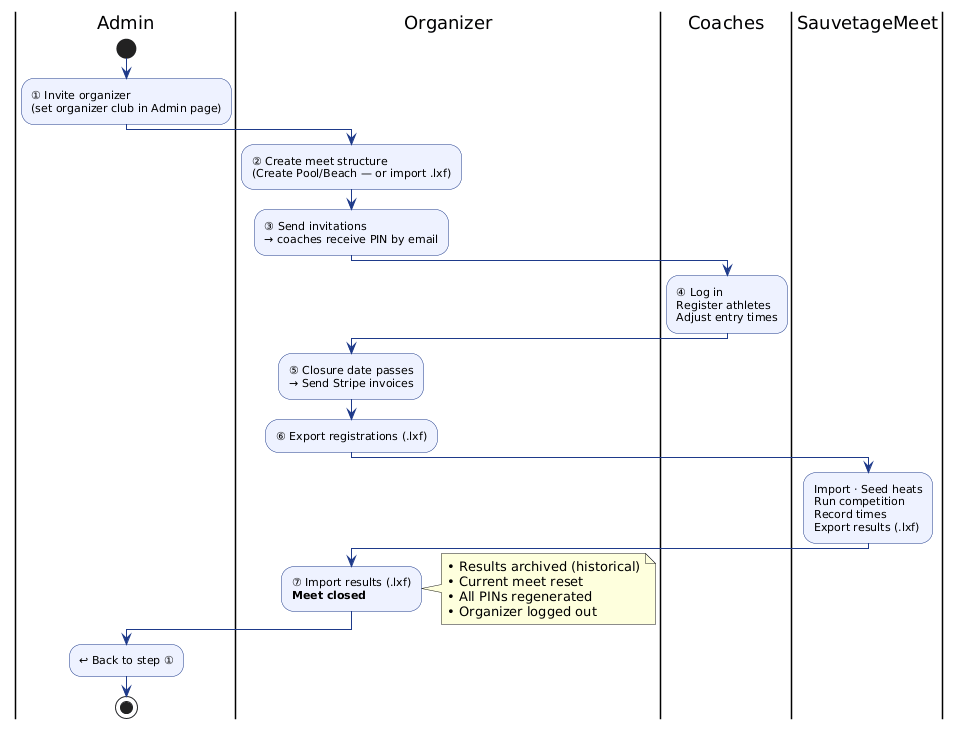
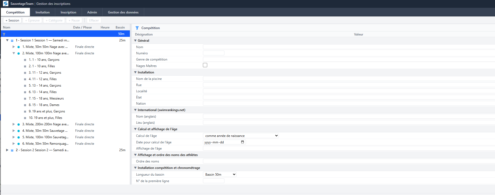

# SauvetageTeam — Organizer Guide

## Overview

The organizer manages the full meet cycle: creating the structure, sending invitations, collecting registrations, sending invoices, and finally importing results to close the meet. This role has access to the **Meet**, **Invitation**, **Individual Entries**, **Relay Entries**, and **SERC** tabs.

---

## Login

1. Open the SauvetageTeam app in a browser
2. Enter the **organizer club PIN** (provided by the administrator)
3. Click **Login**

---

## Meet Tab — Competition Structure

### Create a New Meet

1. In the **Invitation** tab toolbar, click **Create Pool** or **Create Beach**
2. Confirm the dialog — this wipes the current event structure and loads the template
3. The event tree refreshes with the standard events for the chosen meet type

> **Note**: This only resets the event structure. Clubs and athletes are preserved.

### View the Event Tree

The Meet tab displays the full competition structure as a tree:
- **Sessions** (morning, afternoon, etc.)
- **Events** within each session (50m Obstacle Swim, 100m Rescue Medley, etc.)
- **Age groups** within each event

### Upload Meet Structure

1. In the toolbar, click **Upload Meet Structure (.lxf)**
2. Select the `.lxf` file exported from SauvetageMeet
3. The app loads all events, pool size, masters flag, and fees

> **Important**: Uploading a new structure replaces the current one. All existing registrations will be deleted.

### Fee Summary

After uploading a meet structure, the **Fee Summary** box displays:
- Meet-level fees (per athlete, per club)
- Per-event fees (timing events)
- Currency

### Entry Deadline

The entry deadline is set in the meet configuration panel:
1. In the **Meet** tab, open the **Competition** config panel → **Others** section
2. Set the **Entry deadline** date
3. This date is displayed read-only on the Invitation tab and enforces registration closure

---

## Invitation Tab — Managing Club Invitations

### Entry Closure Date

The entry closure date is configured in the **Meet** tab under **Competition → Others → Entry deadline**. The Invitation tab displays the closure date in read-only mode for reference.

- Coaches can register until this date; after closure the form becomes read-only

### Send Invitations

1. In the **Team Invites** section, select clubs to invite (checkboxes or select all)
2. Click **Send Invitation**
3. Each coach receives an email with a one-time secure link to retrieve their club PIN

> **Note**: Clubs must have an email address configured in the Admin page.

### Monitor Invitation Status

The invitation list shows:
- ✅ Invitation sent (with date)
- 📧 Email pending
- 🔗 Link clicked (PIN revealed)

### Self-Invite (Alternative Flow)

Coaches can request their own invitation from the login page:
1. Click **Request an Invitation**
2. Select their club, confirm email, click **Send Invitation**

---

## After Closure — Export Registrations

1. After the closure date, click **Download LXF** in the Invitation tab toolbar
2. Import the `.lxf` file into SauvetageMeet: **File → Import LENEX**
3. All athletes, clubs, and entry times are loaded into SauvetageMeet

---

## After Closure — Send Invoices

Once the registration deadline has passed, select clubs in the Invitation tab (checkboxes). Three buttons are available:

| Button | What it does |
|---|---|
| **Download PDF** | Downloads a ZIP with one PDF invoice per selected club |
| **Send PDF** | Emails each club its invoice (PDF attached) with instructions to pay by **Interac e-Transfer** to the organizer club's email, putting the invoice number in the message/memo field. Replies go to the organizer. |
| **Send Stripe** | Sends a Stripe invoice (clubs pay by card). Only enabled when Stripe is connected. |

Both send buttons ask for confirmation first ("Do you want to send X invoices now?"). Clubs without an email can only get a PDF download. The **Status** column shows how many times each club was sent an invoice (`2× sent`), by email or Stripe.

After **Send PDF**, the organizer club receives **one summary email** listing every invoice the platform just sent in its name (club, email, invoice number, total).

### Invoice numbers

Each invoice has a stable number `YEAR-MEET-CLUB`, e.g. `2026-012-0045` — the same on the PDF, the email, and the Stripe invoice. If a club's total changes after an invoice was sent (late registration, withdrawal), the next send gets a revision suffix: `2026-012-0045-R2`. Re-sending an unchanged invoice keeps the same number. Use the number in the Interac memo to match payments to clubs.

Autodeposit is not used: clubs are told to set the security question **"What is the invoice number?"** with their invoice number as the answer. When you deposit a transfer, answer with that club's invoice number (listed in the summary email you receive after each batch).

> **Note**: Fees are configured in the meet structure. The organizer club's email (Admin) is the Interac e-Transfer recipient — make sure it's correct before sending.

---

## Individual Entries & Relay Entries Tabs

The organizer can register athletes from any club and modify entries (same interface as coaches, but not limited to their own club):

- **Individual Entries** tab — register/unregister athletes for individual events, manage entry times
- **Relay Entries** tab — manage relay team composition and member assignments

See the [Coach Guide](team-coach) for details on the registration interface.

---

## SERC Tab

The SERC (Simulated Emergency Response Competition) tab is available for organizers and admins. It provides:

- **Setup & Factors** — configure the number of victims, victim types, approach/rescue/control factors, overall and bystander criteria
- **Scoring** — grid-based score entry with teams in columns and criteria in rows. Supports random draw and final draw ordering.
- **Results** — ranked totals across all sections
- **Judge QR Codes** — generate QR codes for mobile judge entry (one per section, no login needed)
- **Print Sheets** — generate printable bilingual judge sheets

---

## After the Competition — Import Results (Close the Meet)

Once the competition is over and results have been exported from SauvetageMeet:

1. In SauvetageMeet, use **File → Export results LENEX…** to save a `.lxf` results file
2. In SauvetageTeam (Invitation tab), click **Import Results**
3. A confirmation modal appears — review the warning carefully. This action is **irreversible** and will:
   - Archive results as a completed historical meet (used for future best times)
   - Reset the current meet **for both admin and organizer** (all registrations and event structure cleared)
   - Regenerate all club PINs (coaches must re-authenticate for the next meet)
   - Clear the organizer role and **log you out**
4. After logout, the administrator can invite the organizer for the next meet

> **Admin note**: After a results import, the system is back to step ①. The meet is reset for both admin and organizer. Designate the next organizer in the Admin page.

---

## Workflow Summary

| Step | Action | Role | Tool |
|------|--------|------|------|
| ① | Invite organizer | Admin | SauvetageTeam |
| ② | Create meet structure | Organizer | SauvetageTeam (or SauvetageMeet → export) |
| ③ | Send invitations to clubs | Organizer | SauvetageTeam |
| ④ | Register athletes | Coaches | SauvetageTeam |
| ⑤ | Send invoices — PDF/Interac by email or Stripe (collect fees) | Organizer | SauvetageTeam |
| ⑥ | Export registrations (.lxf) → Run competition | Organizer + SauvetageMeet | Both |
| ⑦ | Import results (.lxf) → meet closed | Organizer | SauvetageTeam |
