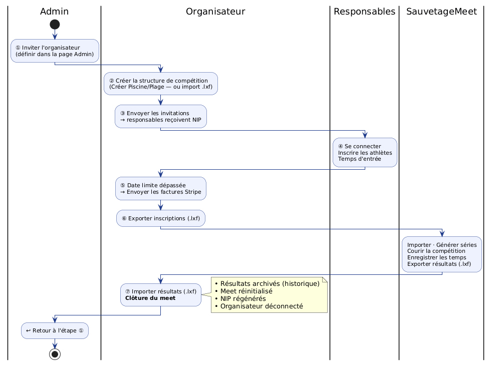
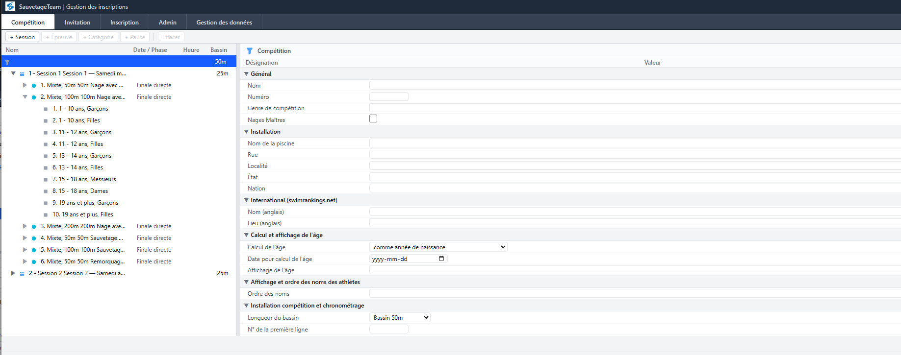

# SauvetageTeam — Guide de l'organisateur

## Vue d'ensemble

L'organisateur gère le cycle complet de la compétition : création de la structure, envoi des invitations, collecte des inscriptions, facturation et importation des résultats pour clôturer le meet. Ce rôle a accès aux onglets **Compétition**, **Invitation**, **Inscriptions individuelles**, **Inscriptions relais** et **SERC**.

---

## Connexion

1. Ouvrir l'application SauvetageTeam dans un navigateur
2. Entrer le **NIP du club organisateur** (fourni par l'administrateur)
3. Cliquer **Connexion**

---

## Onglet Compétition — Structure de la compétition

### Créer un nouveau meet

1. Dans la barre d'outils de l'onglet **Invitation**, cliquer **Créer Piscine** ou **Créer Plage**
2. Confirmer le dialogue — ceci efface la structure d'épreuves actuelle et charge le gabarit
3. L'arbre des épreuves se rafraîchit avec les épreuves standard du type choisi

> **Note** : Ceci ne réinitialise que la structure d'épreuves. Les clubs et athlètes sont préservés.

### Visualiser l'arbre des épreuves

L'onglet Compétition affiche la structure complète sous forme d'arbre :
- **Sessions** (matin, après-midi, etc.)
- **Épreuves** dans chaque session (50m Nage avec obstacles, 100m Sauvetage combiné, etc.)
- **Catégories d'âge** dans chaque épreuve

### Téléverser la structure de la compétition

1. Dans la barre d'outils, cliquer **Téléverser structure (.lxf)**
2. Sélectionner le fichier `.lxf` exporté depuis SauvetageMeet
3. L'application charge toutes les épreuves, la taille du bassin, le drapeau Masters et les tarifs

> **Important** : Téléverser une nouvelle structure remplace la structure actuelle. Toutes les inscriptions existantes seront supprimées.

### Résumé des frais

Après le téléversement d'une structure, la boîte **Résumé des frais** affiche :
- Frais au niveau de la compétition (par athlète, par club)
- Frais par épreuve (épreuves chronométrées)
- Devise

### Date limite d'inscription

La date limite d'inscription est configurée dans le panneau de configuration de la compétition :
1. Dans l'onglet **Compétition**, ouvrir le panneau de configuration → section **Autres**
2. Définir la **Date limite d'inscription**
3. Cette date est affichée en lecture seule dans l'onglet Invitation et applique la clôture des inscriptions

---

## Onglet Invitation — Gestion des invitations

### Date limite d'inscription

La date limite d'inscription est configurée dans l'onglet **Compétition** sous **Competition → Autres → Date limite d'inscription**. L'onglet Invitation affiche la date limite en lecture seule à titre de référence.

- Les responsables peuvent inscrire jusqu'à cette date ; après la clôture, le formulaire devient en lecture seule

### Envoyer les invitations

1. Dans la section **Invitations aux équipes**, sélectionner les clubs à inviter
2. Cliquer **Envoyer l'invitation**
3. Chaque responsable reçoit un courriel avec un lien sécurisé à usage unique pour récupérer son NIP

> **Note** : Les clubs doivent avoir une adresse courriel configurée dans la page Admin.

### Suivre le statut des invitations

La liste des invitations affiche :
- ✅ Invitation envoyée (avec date)
- 📧 Courriel en attente
- 🔗 Lien cliqué (NIP révélé)

### Auto-invitation (flux alternatif)

Les responsables peuvent demander leur propre invitation depuis la page de connexion :
1. Cliquer **Demander une invitation**
2. Sélectionner leur club, confirmer le courriel, cliquer **Envoyer l'invitation**

---

## Après la clôture — Exporter les inscriptions

1. Après la date limite, cliquer **Télécharger LXF** dans la barre d'outils de l'onglet Invitation
2. Importer le fichier `.lxf` dans SauvetageMeet : **Fichier → Importer un fichier LENEX**
3. Tous les athlètes, clubs et temps d'inscription sont chargés dans SauvetageMeet

---

## Après la clôture — Envoyer les factures

Une fois la date limite d'inscription passée, sélectionner les clubs dans l'onglet Invitation (cases à cocher). Trois boutons sont disponibles :

| Bouton | Action |
|---|---|
| **Télécharger PDF** | Télécharge un ZIP contenant une facture PDF par club sélectionné |
| **Envoyer PDF** | Envoie à chaque club sa facture par courriel (PDF joint) avec les instructions pour payer par **virement Interac** au courriel du club organisateur, en inscrivant le numéro de facture dans le champ message / mémo. Les réponses sont adressées à l'organisateur. |
| **Envoyer Stripe** | Envoie une facture Stripe (paiement par carte). Actif seulement si Stripe est connecté. |

Les deux boutons d'envoi demandent une confirmation (« Voulez-vous envoyer X factures maintenant ? »). Les clubs sans courriel ne peuvent recevoir qu'un PDF téléchargé. La colonne **Statut** indique combien de fois une facture a été envoyée à chaque club (`2× envoyé`), par courriel ou par Stripe.

Après **Envoyer PDF**, le club organisateur reçoit **un seul courriel récapitulatif** listant toutes les factures que la plateforme vient d'envoyer en son nom (club, courriel, n° de facture, total).

### Numéros de facture

Chaque facture a un numéro stable `ANNÉE-MEET-CLUB`, p. ex. `2026-012-0045` — le même sur le PDF, le courriel et la facture Stripe. Si le total d'un club change après l'envoi d'une facture (inscription tardive, retrait), l'envoi suivant reçoit un suffixe de révision : `2026-012-0045-R2`. Renvoyer une facture inchangée conserve le même numéro. Utilisez ce numéro dans le mémo Interac pour associer les paiements aux clubs.

Le dépôt automatique n'est pas utilisé : les clubs doivent ajouter la question de sécurité **« Quel est le numéro de facture? »** avec leur numéro de facture comme réponse. Pour déposer un virement, répondez avec le numéro de facture du club (indiqué dans le courriel récapitulatif reçu après chaque envoi).

> **Note** : Les tarifs sont configurés dans la structure de compétition. Le courriel du club organisateur (Admin) est le destinataire des virements Interac — vérifiez-le avant l'envoi.

---

## Onglets Inscriptions individuelles et Inscriptions relais

L'organisateur peut inscrire des athlètes de n'importe quel club et modifier les inscriptions (même interface que les responsables, mais sans restriction de club) :

- **Inscriptions individuelles** — inscrire/désinscrire les athlètes aux épreuves individuelles, gérer les temps d'inscription
- **Inscriptions relais** — gérer la composition des équipes de relais et l'assignation des membres

Voir le [Guide du responsable d'équipe](team-coach) pour les détails de l'interface.

---

## Onglet SERC

L'onglet SERC (Simulated Emergency Response Competition) est disponible pour les organisateurs et admins. Il offre :

- **Configuration et facteurs** — configurer le nombre de victimes, les types, les facteurs d'approche/sauvetage/contrôle, les critères globaux et du passant
- **Pointages** — grille de saisie avec les équipes en colonnes et les critères en lignes. Supporte le tirage aléatoire et le tirage final.
- **Résultats** — totaux classés pour toutes les sections
- **Codes QR juges** — générer des codes QR pour la saisie mobile par les juges (un par section, aucune connexion requise)
- **Feuilles d'impression** — générer des feuilles de juges imprimables bilingues

---

## Après la compétition — Importer les résultats (clôturer le meet)

Une fois la compétition terminée et les résultats exportés depuis SauvetageMeet :

1. Dans SauvetageMeet, utiliser **Fichier → Exporter les résultats LENEX…** pour sauvegarder un fichier `.lxf`
2. Dans SauvetageTeam (onglet Invitation), cliquer **Importer résultats**
3. Une fenêtre de confirmation apparaît — lire l'avertissement attentivement. Cette action est **irréversible** et va :
   - Archiver les résultats comme meet historique (utilisé pour les futurs meilleurs temps)
   - Réinitialiser le meet actuel **pour l'admin et l'organisateur** (inscriptions et structure d'épreuves effacées)
   - Régénérer les NIP de tous les clubs (les responsables devront se reconnecter)
   - Effacer le rôle d'organisateur et **vous déconnecter**
4. Après la déconnexion, l'administrateur peut inviter l'organisateur du prochain meet

> **Note pour l'admin** : Après l'import des résultats, le système est de retour à l'étape ①. Le meet est réinitialisé pour l'admin et l'organisateur. Désigner le prochain organisateur dans la page Admin.

---

## Résumé du flux complet

| Étape | Action | Rôle | Outil |
|-------|--------|------|-------|
| ① | Inviter l'organisateur | Admin | SauvetageTeam |
| ② | Créer la structure de compétition | Organisateur | SauvetageTeam (ou SauvetageMeet → export) |
| ③ | Envoyer les invitations aux clubs | Organisateur | SauvetageTeam |
| ④ | Inscrire les athlètes | Responsables | SauvetageTeam |
| ⑤ | Envoyer les factures — PDF/Interac par courriel ou Stripe (collecter les frais) | Organisateur | SauvetageTeam |
| ⑥ | Exporter les inscriptions (.lxf) → Courir la compétition | Organisateur + SauvetageMeet | Les deux |
| ⑦ | Importer les résultats (.lxf) → meet clôturé | Organisateur | SauvetageTeam |
